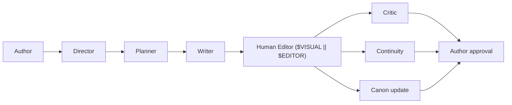

# AGENTS.md — pi-novel-scribe

> **Project guide for agent tools.** Canonical entrypoint — there is no `CLAUDE.md`.
> Built as a [pi](https://pi.dev/) extension (TypeScript) for long-form novel writing.
> Global orchestrator at `~/.agents/AGENTS.md` (symlinked as `~/AGENTS.md`).

## Project at a glance

- **Name:** pi-novel-scribe — Pi extension for autonomous long-form novel writing
- **Runtime:** [Pi](https://github.com/earendil-works/pi) v0.85+ (Mario Zechner / badlogic)
- **Language:** TypeScript (erasable syntax only — see [Conventions](#conventions))
- **Status:** v0.1+, v0.2, and v0.3 milestones complete (14 implementation phases shipped); **v0.4 scoped** (Phase 15 prompt improvement — rewrite the 5 agent system prompts in `prompts/*.md` + `prompts/zh/*.md` to the structural template distilled from the wst SQLite `prompts` corpus; per ADR-0013 Q33). `pi-novel-architecture-review.md` v0.4 with Q1–Q38 locked; 282/282 tests passing (Phase 15 target = 283 with one structural-invariants test).
- **Primary principle:** Pi is the runtime; the extension provides novel-specific orchestration. The author remains the final authority on canon.

## Where to look

| Need | Read |
|---|---|
| **Design decisions, schemas, workflows, agent contracts** | [pi-novel-architecture-review.md](./pi-novel-architecture-review.md) — the spec |
| **Pi extension API, events, tools, commands** | [pi docs: extensions](https://pi.dev/docs/extensions) · [packages](https://pi.dev/docs/packages) · [skills](https://pi.dev/docs/skills) |
| **Global orchestrator** (Major + 7 specialists) | `~/.agents/AGENTS.md` |
| **Global engineering rules** | `~/.copilot/copilot-instructions.md` |

---

## Commands

Run from repo root unless noted.

```bash
# Develop
npm install                                     # install deps (in this repo)
npm run typecheck                               # tsc --noEmit
npm run lint                                    # biome check
npm run format                                  # biome format --write
npm run check                                   # lint + typecheck (matches pi convention)

# Try the extension locally without installing
pi -e ./extensions/index.ts                     # load extension from cwd

# Try a single skill / prompt
pi --skill ./skills/snowflake
pi -e ./extensions/index.ts -p "/novel write"

# Install as a pi package (project-local, after trust)
pi install ./                                   # add to .pi/settings.json
pi install ./ -l                                # explicit project-local install

# Distribute
npm pack                                        # build tarball for `pi install npm:./pkg.tgz`
```

> `npm run check` (lint + typecheck) is the quality gate before marking work done; `npm test` is the regression gate. Both must be clean (exit 0) before any phase is marked complete.

### Real-pi smoke against the sample novel

The unit smoke (`tests/smoke.test.ts`) covers the mocked-LLM end-to-end path. For a real-LLM end-to-end smoke against `examples/novel-scribe-demo/` (mode (b) per the v0.2 planning), two project-local configs are required (both untracked — `.pi/` is gitignored):

1. **Project-local `.pi/settings.json`** at the **project root** pointing `novelRepo` at the sample and `wikiDbPath` at a nonexistent file (forces the ADR-0008 degradation path). This file is smoke-only — delete after the smoke so it doesn't change the extension's default novelRepo resolution.
2. **`.pi/extensions/pi-permission-system/config.json`** with the extension's tools (`delegate_to_planner`, `delegate_to_writer`, `delegate_to_critic`, `wiki_search`, `run_director`) set to `"allow"`. Without this, pi's permission system blocks tool calls in headless mode (no interactive UI). This file SHOULD stay — it's the natural permission config for future real-pi smoke runs.

Then from the project root:

```bash
perl -e 'alarm 360; exec @ARGV' pi --provider MiniMax --model MiniMax-M3 \
  -e ./extensions/index.ts \
  -p "Call the delegate_to_writer tool now with chapter_id='0001.md' to draft the chapter."
```

The smoke produces real prose (mode (b) takes ~30–90s end-to-end with the MiniMax-M3 model), transitions the chapter's `status` to `human_editing`, and exercises the wiki degradation path (`wikiReferences: null` + warning, never blocks writing).

**Latent finding worth flagging for v0.3 scoping:** the Writer's `writeFileSync` overwrites the chapter with prose-only — any pre-existing frontmatter fields (`chapter:`, `pov:`, `plan:`, `review:`) get wiped. `applyStatus` then adds `status:` back, but other fields are gone. The unit smoke hides this because the mock LLM never produces frontmatter lines. The fix would be to merge the new prose into the existing file rather than overwrite.

---

## Architecture (1-minute summary)

Full detail in [pi-novel-architecture-review.md](./pi-novel-architecture-review.md). The vertical:



| Layer | Responsibility | Lives in |
|---|---|---|
| **Director** | Thin orchestrator — interprets intent, picks workflow, delegates | `extensions/agents/director.ts` |
| **Planner** | Structure: premise → snowflake → arc → chapter → scene plans | `extensions/agents/planner.ts` |
| **Writer** | Prose; emits `manuscript + proposed_state_changes` | `extensions/agents/writer.ts` |
| **Critic** | Actionable issues: plot, character, pacing, prose, foreshadowing | `extensions/agents/critic.ts` |
| **Continuity** | Canon authority: facts, timeline, character knowledge, threads | `extensions/agents/continuity.ts` |
| **Subagents** | Narrow specialists (Snowflake Specialist, Scene Planner, Dialogue Specialist, Fact Checker, …) | `extensions/subagents/` |
| **Skills** | Reusable writing methodologies loaded on demand | `skills/<name>/SKILL.md` |
| **Novel State** | Durable canonical information (characters, world, story, chapters, foreshadowing) | The user's novel repo, not this one |
| **External editor** | `$VISUAL` → `$EDITOR` → platform default; awaited, before/after diff | `extensions/editor/` |
| **Workflows** | Resumable state machines exposed as slash commands | `extensions/workflow/` |

Slash commands (MVP): `/novel plan`, `/novel write`, `/novel review`, `/novel revise`, `/novel continue`.

### Five hard design rules

These are non-negotiable. Violating any of them breaks the system.

1. **The author is the final authority on canon.** Writers propose; Continuity validates; the author approves. Never auto-promote a Writer-generated fact to canon. (§8)
2. **Character knowledge ≠ world truth.** Model `fact.truth` separately from `knowledge.{character, reader}` so mystery / dark-line stories stay coherent. (§B in review)
3. **The Writer consumes an approved plan.** Provisional plans are allowed but explicit. Never let the Writer reshape structure while drafting. (§E)
4. **Story Lines track information, not just events.** Bright line + dark line each carry `truth`, `who_knows`, `what_reader_suspects`, `planned_reveal`. (§C, §10)
5. **Scene is first-class.** `Novel → Major Arc → Arc → Chapter → Scene → (Beat)`. Beats can wait; Scenes cannot. (§D)

---

## Layout (current — Phase 0–10 shipped)

```
pi-novel-scribe/
├── package.json                # pi manifest + scripts (vitest 5, biome 2.5, TS 7)
├── tsconfig.json               # strict, Node strip-only (erasable TS)
├── biome.json                  # lint + format (v2 schema)
├── vitest.config.ts            # v8 coverage provider
│
├── extensions/                 # pi auto-loads from this convention dir
│   ├── index.ts                # ExtensionAPI default export; registers Director + 5 agents + status widget + wiki_search tool
│   ├── commands/novel-write.ts # /novel write handler
│   ├── agents/                 # director, planner, writer, critic, continuity (LLM-driven via ctx.modelRegistry.complete)
│   ├── orchestrator/           # director.ts (registers the Director tool) + route.ts (loadRouteTable, matchRoute, phrase > keyword priority)
│   ├── novel/                  # schemas, canon, canon-approval, continuity (read), continuity-refresh,
│   │                           #   context, plan-context, critic-context, resume-scan, requires-state, yaml-extract
│   ├── editor/                 # open.ts (VISUAL/EDITOR + platform fallback, Injection), gate.ts (openApprovalGate + decideOutcome)
│   ├── state/path-resolver.ts  # novelRepo resolution (Q1 / ADR-0001)
│   ├── workflow/               # status.ts (10-status enum + frontmatter parser/serializer),
│   │                           # transitions.ts (13-edge graph + BFS path finder)
│   ├── tmux/widget.ts          # Phase 7 status widget (works without tmux)
│   ├── wiki/                   # ADR-0006: schema.ts, db.ts (node:sqlite via createRequire),
│   │                           #   fts.ts (FTS5 BM25 candidates), rerank.ts (LLM top-5),
│   │                           #   index.ts (public searchWiki entry)
│   │                           # ADR-0008: cache.ts (session-scoped in-memory rerank cache + budget),
│   │                           #   context.ts (deterministic query derivation + packet injection + Q22 validation)
│   └── tools/wiki-search.ts    # pi tool wrapper for the wiki
│
├── config/route.yaml           # 9 intents (write, plan, review, revise, continue, inspect, investigate, approve, reject)
├── prompts/                    # agent prompt templates (Markdown, en + zh, loaded by Writer/Planner/Critic at runtime)
│
├── tests/                      # 28 vitest spec files (270 tests, 82.x% statement coverage)
│   └── _helpers/               # fakePi.ts (captures registered tools), fakeChild.ts (EventEmitter-based spawn),
│                               #   wikiFixture.ts (shared FTS5 SQLite fixture for wiki packet tests)
│
└── docs/
    ├── README.md               # doc index
    ├── adr/                    # 8 ADRs (0001–0008)
    └── phase-7/README.md       # tmux UI stance + opt-in layout
```

> **Layout reflects what's actually shipped**, not what was planned. The architecture review's §29 design priorities are now resolved (see §"Project status" below). Skills, subagents, and `subagents/` are **deferred** (ADR-0005: subagents earned, not declared; skills come when measured need appears).

---

## Conventions

### Pi extension conventions (mandatory)

- **Erasable TypeScript only.** No `enum`, no `namespace`, no `parameter properties`, no `import =`, no `export =`. Node strip-only mode. Use `StringEnum` from `@earendil-works/pi-ai` for string unions (Google API compatibility).
- **No `any`.** If you can't type it, narrow the source.
- **No inline imports.** `await import()` is forbidden. Top-level imports only.
- **Check `node_modules` for external API types** — never guess pi-ai / pi-coding-agent / typebox signatures.
- **Truncate tool output.** Use `truncateHead` / `truncateTail` from `@earendil-works/pi-coding-agent`. Default `DEFAULT_MAX_BYTES` (50KB) and `DEFAULT_MAX_LINES` (2000). On truncation, write full output to a temp file and tell the LLM where to find it.
- **File mutations must queue.** Use `withFileMutationQueue(absolutePath, async () => …)` from `@earendil-works/pi-coding-agent` so custom tools don't race with the built-in `edit` / `write` in parallel tool mode. Pass the resolved absolute path (`resolve(ctx.cwd, params.path)` then `realpath`).
- **Tools signal errors by throwing**, not by returning `{ isError: true }`. Throw → caught → `isError: true` on the result.
- **Persisted state belongs in tool `details`**, not in module-level closures. Reconstruct from `ctx.sessionManager.getBranch()` on `session_start` for branch-correct session restore.
- **Output is free-form prose; planning/review/state-changes are structured YAML.** Match §19 of the review.
- **Register custom tools with `promptSnippet`** (one-line description in the `Available tools` section) and **`promptGuidelines` with the tool name in every bullet** (LLMs cannot tell which tool "this" means otherwise).
- **Async factories are fine**; `pi` awaits them before `session_start`. But don't start background processes / sockets / file watchers from the factory — defer to `session_start`.
- **For pi packages, list core pi deps in `peerDependencies`** with `"*"` range (`@earendil-works/pi-ai`, `pi-agent-core`, `pi-coding-agent`, `pi-tui`, `typebox`). Third-party pi packages go in `dependencies` + `bundledDependencies`.

### Project conventions

- **Spec → Task → Code.** Read the relevant section of [pi-novel-architecture-review.md](./pi-novel-architecture-review.md) before writing files. The review is the spec. ADR-only changes get recorded in `docs/adr/`.
- **One responsibility per agent / subagent.** The Director must stay thin (no prose, no canonical logic, no reviews). §20.
- **No silent canon mutations.** Every writer → continuity proposal goes through `extensions/tools/canon_propose.ts`, never through `write` / `edit` directly.
- **State changes are explicit and reversible.** Canon states: `idea → draft → proposed → validated → approved/canon`. Possible: `deprecated`, `contradicted`. (§8)
- **Workflows are resumable.** States: `created → planning → planned → writing → drafted → human_editing → edited → continuity_check → reviewing → revision_required → approved → canonized`. Pi exiting during `human_editing` must not lose work. (§18)
- **Human approval levels** (configurable per novel repo):
  - `0` automatic — read state, generate draft, generate review
  - `1` notify — open editor
  - `2` ask — proposed canon change
  - `3` explicit approval — major storyline change, replace substantial existing prose, delete established canon (§15)
- **Recursion limits are mandatory.** Every delegated operation carries `max_agent_depth`, `max_subagents`, `max_iterations`, `max_tokens`, `max_time`. The Director must eventually require human judgment. (§22)
- **Don't duplicate what the novel repo will own.** This extension is stateless across novels — the novel repository holds `world/`, `characters/`, `story/`, `chapters/`, `reviews/`, `state/`. Don't import novel data into the extension; use the configured `novelRepo` path.
- **Git is infrastructure, not the domain model.** Novel repos are Git-friendly, but versioning logic lives in Novel State (semantic), not in git (historical). (§9, §H)

### Engineering rules (inherited from global)

These come from `~/.copilot/copilot-instructions.md` and apply unless this file overrides them:

- **Surgical changes.** Touch only what the request requires. Match existing style.
- **Read before writing.** Search for existing utilities before adding new ones. Extend, don't duplicate.
- **No backward-compat cruft.** When the architecture review changes, remove the old path instead of adding compatibility shims.
- **No ghost code / commented-out blocks.** Git remembers.
- **Deterministic code, not LLM calls.** Retry policies, validation, routing, thresholds, status-code handling stay in normal code. LLM output is for language reasoning, not control flow.
- **Tests assert behavior, not implementation.** Passing tests ≠ correct tests. Read what the assertion actually checks.

---

## Where to start (when implementing)

The architecture review's §29 names the priority order. For Phase 0 (extension skeleton) this is the path of least resistance:

1. **Scaffold the package** — `package.json` with the `pi` manifest, `tsconfig.json` (strict, erasable), `biome.json`, `extensions/index.ts` that registers `/novel write` as a stub command.
2. **Validate local loading** — `pi -e ./extensions/index.ts` from this repo. Confirm `session_start` fires and the command is visible.
3. **Then tackle §29 in order.** Schemas (Novel State, Character Knowledge, Scene, Story Line) before agents. Agent contracts before implementations.

---

## Project status (v0.1 milestone complete)

- ✅ **Phase 0 — Design review complete** (`pi-novel-architecture-review.md` v0.4 + Q1–Q16 locked; CONTEXT.md; 5 ADRs)
- ✅ **Phase 0.5 — Substrate scaffold** (npm scaffold, biome, tsconfig, `extensions/index.ts`, status state machine, editor primitive, path resolver)
- ✅ **Phase 1 — External editor** (`extensions/editor/open.ts` + `gate.ts`; mtime-based decideOutcome)
- ✅ **Phase 2 — Agent registry + Director route.yaml router** (5 agents + Director; `config/route.yaml` with 9 intents; matchRoute with phrase > keyword priority)
- ✅ **Phase 3 — Writer end-to-end** (`extensions/agents/writer.ts`; composeSceneContext; writes `prose:` to chapter frontmatter)
- ✅ **Phase 3.5 — Planner end-to-end** (`extensions/agents/planner.ts`; extractYamlBlock; writes `plan:` block)
- ✅ **Phase 3.6 — Critic end-to-end** (`extensions/agents/critic.ts`; composeCriticContext; 5-field issue validation; writes `review:` block)
- ✅ **Phase 4 — Continuity** (read-side: `extensions/novel/continuity.ts` derives reader/character knowledge; refresh mode writes `state/character-beliefs.yaml`)
- ✅ **Phase 5 — Novel State** (P0 schemas: Character, Character Knowledge, Scene, StoryLine, Foreshadowing, UnresolvedThread, TimelineEvent, CanonChange; canon propose/apply/deprecate lifecycle)
- ✅ **Phase 6 — Workflow engine** (13-edge transition graph, gate integration, `requires_state` checks, `canon_approve` tool, resume-on-exit scan)
- ✅ **Phase 7 — tmux UI** (optional tmux layout + `extensions/tmux/widget.ts` custom widget — works in plain pi without tmux; 7 widget tests)
- ✅ **Phase 8 — LLM Wiki** (`extensions/wiki/` + `extensions/tools/wiki-search.ts`; read-only SQLite consumer of the wst NovelScribe reference corpus via `node:sqlite`; FTS5 BM25 → LLM rerank top 5; per ADR-0006; 21 tests)
- ✅ **Phase 9 — Multilingual (en + zh)** (`extensions/i18n/` module + `prompts/zh/*.md`; localized tool descriptions / prompt snippets / status display / error messages; per ADR-0007; override chain = command flag > chapter frontmatter > settings > auto-detect > fallback; `/novel write --lang=zh`; 27 tests)
- ✅ **Phase 10 — Wiki-first context** (per ADR-0008): `extensions/wiki/{cache,context}.ts` add deterministic packet-level injection (Q21) + session-scoped rerank cache + budget (Q23) + Q22 `template_refs` gate; `Scene.template_refs`/`template_refs_exempt` + Critic issue `pattern_ref`; agent prompts consume wikiReferences as the default rhythm; `requires_state` gate enforces Q22; degrades to `null + warning` on wiki failure (never blocks writing); 270/270 tests passing.
- ✅ **Phase 11 — Multi-chapter planning** (per ADR-0009): `/novel plan --chapters=N` batches N successive plan writes into one LLM call; per-block validation isolates failures; Q22 `template_refs` gate runs per block; wiki packet computed once for the batch. 7 tests in `tests/multi-plan.test.ts`.
- ✅ **Phase 12 — Sample novel + CI smoke** (per ADR-0010): `examples/novel-scribe-demo/` peer fixture (5 chapters, 2 characters, 2 story lines, 1 foreshadowing, 1 thread, 1 timeline event, no real `wikiDbPath`) + offscreen vitest smoke (`tests/smoke.test.ts`) driving the full vertical with mocked ModelRegistry. 3 tests. **Latent v0.1+ fix:** `extensions/workflow/status.ts` `parseSimpleYaml` + `serializeFrontmatter` rewrote with js-yaml so the writer's `applyStatus` no longer mangles the planner's object-valued `plan:` block.
- ✅ **Phase 13 — Writer frontmatter safety** (per ADR-0012 Q29, shipped 2026-09-20): the v0.2 real-pi smoke surfaced a latent bug — the Writer's `writeFileSync` overwrites the chapter with prose-only, wiping `chapter:` / `pov:` / `plan:` / `review:` frontmatter. Fix shipped: `mergeProseIntoChapter(chapterPath, prose, fsAdapter?)` helper in `extensions/workflow/status.ts` reuses the existing js-yaml frontmatter parser + serializer to preserve existing frontmatter and append LLM prose below `\n---`. `extensions/agents/writer.ts` calls the new helper instead of `writeFileSync`. New `tests/tool-writer.test.ts` case (`preserves pre-existing frontmatter ...`) seeds a chapter with all four frontmatter keys (simulating the v0.2 end-state) and asserts every key survives the writer call. +1 test (281 total).
- ✅ **Phase 14 — Embedding retrieval evaluation** (per ADR-0012 Q30/Q31, shipped 2026-09-20): extended `tests/_helpers/wikiFixture.ts` with `seedEmbeddingEvalFixture()` populating the `embedding TEXT` column on 15 rows across 3 tables with deterministic 32-dim bag-of-hashes TF vectors (mirror of `extensions/wiki/vector.ts::textToVector`). New `extensions/wiki/vector.ts` (`vectorSearch` / `vectorSearchAll` + `textToVector` + `cosine`) — exports `snippetColumnFor` / `summaryColumnFor` / `languageColumnFor` from `extensions/wiki/fts.ts` to keep the per-table column map single-sourced. New `tests/embedding-eval.test.ts` runs both paths over a 15-query fixed ground truth. **Eval result:** BM25+LLM precision@1 = 0.867 (13/15); vector precision@1 = 0.933 (14/15) → **Q31 verdict: tie-or-better → MERGED.** `extensions/wiki/index.ts` now calls `ftsSearchAll` + `vectorSearchAll`, dedupes the union by `(table, id)` (FTS5 first), and sends the merged candidate set to the LLM rerank. +1 test (282 total).

> **282/282 tests passing, ~82.x% statement coverage.** See `.planning/STATE.md` for the phase-by-phase decision log, `docs/phase-7/README.md` for the tmux/UI stance, `docs/adr/0006-llm-wiki.md` for the wiki design contract, `docs/adr/0007-multilingual.md` for the i18n design contract, `docs/adr/0008-wiki-first-context.md` for the packet-level wiki injection design (amends ADR-0006 §6), `docs/adr/0009-multi-chapter-planning.md` for the multi-chapter scope/batching decisions, `docs/adr/0010-sample-novel-and-ci-smoke.md` for the sample + offscreen smoke decisions, `docs/adr/0011-multi-chapter-tool-param.md` for the tool-parameter clarification, `docs/adr/0012-v0-3-writer-safety-and-embedding-eval.md` for the v0.3 writer-safety + embedding-eval scope (Q28–Q32, Accepted; Phase 13 + Phase 14 shipped), and `docs/adr/0013-v0-4-prompt-improvement.md` for the v0.4 prompt-improvement scope (Q33–Q38, Accepted; Phase 15 pending).

Track progress in a `STATE.md` once implementation begins.