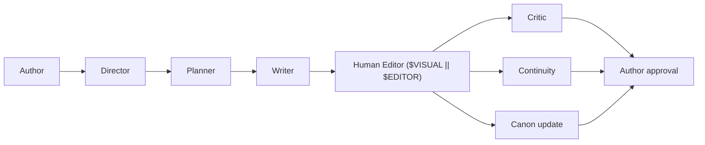

# AGENTS.md — pi-novel-scribe

> **Project guide for agent tools.** Canonical entrypoint — there is no `CLAUDE.md`.
> Built as a [pi](https://pi.dev/) extension (TypeScript) for long-form novel writing.
> Global orchestrator at `~/.agents/AGENTS.md` (symlinked as `~/AGENTS.md`).

## Project at a glance

- **Name:** pi-novel-scribe — Pi extension for autonomous long-form novel writing
- **Runtime:** [Pi](https://github.com/earendil-works/pi) v0.85+ (Mario Zechner / badlogic)
- **Language:** TypeScript (erasable syntax only — see [Conventions](#conventions))
- **Status:** v0.1, v0.2, v0.3, and v0.4 milestones complete (15 implementation phases shipped; v0.4 = Phase 15 prompt improvement per ADR-0013 Q33–Q38 — all 10 agent prompt files in `prompts/*.md` + `prompts/zh/*.md` rewritten to the wst structural template). `pi-novel-architecture-review.md` v0.4 with Q1–Q38 locked; 357/357 tests passing.
- **Primary principle:** Pi is the runtime; the extension provides novel-specific orchestration. The author remains the final authority on canon.

## Where to look

| Need                                                      | Read                                                                                                                                    |
| --------------------------------------------------------- | --------------------------------------------------------------------------------------------------------------------------------------- |
| **Design decisions, schemas, workflows, agent contracts** | [pi-novel-architecture-review.md](./pi-novel-architecture-review.md) — the spec                                                         |
| **Pi extension API, events, tools, commands**             | [pi docs: extensions](https://pi.dev/docs/extensions) · [packages](https://pi.dev/docs/packages) · [skills](https://pi.dev/docs/skills) |
| **Global orchestrator** (Major + 7 specialists)           | `~/.agents/AGENTS.md`                                                                                                                   |
| **Global engineering rules**                              | `~/.copilot/copilot-instructions.md`                                                                                                    |

---

## Commands

Run from repo root unless noted.

```bash
# Develop
npm install                                     # install deps (in this repo)
npm run typecheck                               # tsc --noEmit
npm run lint                                    # biome check
npm run format                                  # biome format --write
npm run check                                   # lint + typecheck (matches pi convention)

# Try the extension locally without installing
pi -e ./extensions/index.ts                     # load extension from cwd

# Try a single skill / prompt
pi --skill ./skills/snowflake
pi -e ./extensions/index.ts -p "/novel write"

# Install as a pi package (project-local, after trust)
pi install ./                                   # add to .pi/settings.json
pi install ./ -l                                # explicit project-local install

# Distribute
npm pack                                        # build tarball for `pi install npm:./pkg.tgz`
```

> `npm run check` (lint + typecheck) is the quality gate before marking work done; `npm test` is the regression gate. Both must be clean (exit 0) before any phase is marked complete.

### Real-pi smoke against the sample novel

The unit smoke (`tests/smoke.test.ts`) covers the mocked-LLM end-to-end path. For a real-LLM end-to-end smoke against `examples/novel-scribe-demo/` (mode (b) per the v0.2 planning), two project-local configs are required (both untracked — `.pi/` is gitignored):

1. **Project-local `.pi/settings.json`** at the **project root** pointing `novelRepo` at the sample and `wikiDbPath` at a nonexistent file (forces the ADR-0008 degradation path). This file is smoke-only — delete after the smoke so it doesn't change the extension's default novelRepo resolution.
2. **`.pi/extensions/pi-permission-system/config.json`** with the extension's tools (`delegate_to_planner`, `delegate_to_writer`, `delegate_to_critic`, `wiki_search`, `run_director`) set to `"allow"`. Without this, pi's permission system blocks tool calls in headless mode (no interactive UI). This file SHOULD stay — it's the natural permission config for future real-pi smoke runs.

Then from the project root:

```bash
perl -e 'alarm 360; exec @ARGV' pi --provider MiniMax --model MiniMax-M3 \
  -e ./extensions/index.ts \
  -p "Call the delegate_to_writer tool now with chapter_id='0001.md' to draft the chapter."
```

The smoke produces real prose (mode (b) takes ~30–90s end-to-end with the MiniMax-M3 model), transitions the chapter's `status` to `human_editing`, and exercises the wiki degradation path (`wikiReferences: null` + warning, never blocks writing).

---

## Architecture (1-minute summary)

Full detail in [pi-novel-architecture-review.md](./pi-novel-architecture-review.md). The vertical:



| Layer               | Responsibility                                                                                 | Lives in                            |
| ------------------- | ---------------------------------------------------------------------------------------------- | ----------------------------------- |
| **Director**        | Thin orchestrator — interprets intent, picks workflow, delegates                               | `extensions/agents/director.ts`     |
| **Planner**         | Structure: premise → snowflake → arc → chapter → scene plans                                   | `extensions/agents/planner.ts`      |
| **Writer**          | Prose; emits `manuscript + proposed_state_changes`                                             | `extensions/agents/writer.ts`       |
| **Critic**          | Actionable issues: plot, character, pacing, prose, foreshadowing                               | `extensions/agents/critic.ts`       |
| **Continuity**      | Canon authority: facts, timeline, character knowledge, threads                                 | `extensions/agents/continuity.ts`   |
| **Subagents**       | Narrow specialists (Snowflake Specialist, Scene Planner, Dialogue Specialist, Fact Checker, …) | `extensions/subagents/`             |
| **Skills**          | Reusable writing methodologies loaded on demand                                                | `skills/<name>/SKILL.md`            |
| **Novel State**     | Durable canonical information (characters, world, story, chapters, foreshadowing)              | The user's novel repo, not this one |
| **External editor** | `$VISUAL` → `$EDITOR` → platform default; awaited, before/after diff                           | `extensions/editor/`                |
| **Workflows**       | Resumable state machines exposed as slash commands                                             | `extensions/workflow/`              |

Slash commands (MVP): `/novel plan`, `/novel write`, `/novel review`, `/novel revise`, `/novel continue`.

### Five hard design rules

These are non-negotiable. Violating any of them breaks the system.

1. **The author is the final authority on canon.** Writers propose; Continuity validates; the author approves. Never auto-promote a Writer-generated fact to canon. (§8)
2. **Character knowledge ≠ world truth.** Model `fact.truth` separately from `knowledge.{character, reader}` so mystery / dark-line stories stay coherent. (§B in review)
3. **The Writer consumes an approved plan.** Provisional plans are allowed but explicit. Never let the Writer reshape structure while drafting. (§E)
4. **Story Lines track information, not just events.** Bright line + dark line each carry `truth`, `who_knows`, `what_reader_suspects`, `planned_reveal`. (§C, §10)
5. **Scene is first-class.** `Novel → Major Arc → Arc → Chapter → Scene → (Beat)`. Beats can wait; Scenes cannot. (§D)

---

## Layout (current — v0.3 shipped)

```
pi-novel-scribe/
├── package.json                # pi manifest + scripts (vitest 5, biome 2.5, TS 7)
├── tsconfig.json               # strict, Node strip-only (erasable TS)
├── biome.json                  # lint + format (v2 schema)
├── vitest.config.ts            # v8 coverage provider
│
├── extensions/                 # pi auto-loads from this convention dir
│   ├── index.ts                # ExtensionAPI default export; registers Director + 5 agents + status widget + wiki_search tool
│   ├── commands/novel-write.ts # /novel write handler
│   ├── agents/                 # director, planner, writer, critic, continuity (LLM-driven via ctx.modelRegistry.complete)
│   ├── orchestrator/           # director.ts (registers the Director tool) + route.ts (loadRouteTable, matchRoute, phrase > keyword priority)
│   ├── novel/                  # schemas, canon, canon-approval, continuity (read), continuity-refresh,
│   │                           #   context, plan-context, critic-context, resume-scan, requires-state, yaml-extract
│   ├── editor/                 # open.ts (VISUAL/EDITOR + platform fallback, Injection), gate.ts (openApprovalGate + decideOutcome)
│   ├── state/path-resolver.ts  # novelRepo resolution (Q1 / ADR-0001)
│   ├── workflow/               # status.ts (10-status enum + frontmatter parser/serializer),
│   │                           # transitions.ts (13-edge graph + BFS path finder)
│   ├── tmux/widget.ts          # Phase 7 status widget (works without tmux)
│   ├── wiki/                   # ADR-0006: schema.ts, db.ts (node:sqlite via createRequire),
│   │                           #   fts.ts (FTS5 BM25 candidates), rerank.ts (LLM top-5),
│   │                           #   index.ts (public searchWiki entry)
│   │                           # ADR-0008: cache.ts (session-scoped in-memory rerank cache + budget),
│   │                           #   context.ts (deterministic query derivation + packet injection + Q22 validation)
│   └── tools/wiki-search.ts    # pi tool wrapper for the wiki
│
├── config/route.yaml           # 9 intents (write, plan, review, revise, continue, inspect, investigate, approve, reject)
├── prompts/                    # agent prompt templates (Markdown, en + zh, loaded by Writer/Planner/Critic at runtime)
│
├── tests/                      # 34 vitest spec files (357 tests)
│   └── _helpers/               # fakePi.ts (captures registered tools), fakeChild.ts (EventEmitter-based spawn),
│                               #   wikiFixture.ts (shared FTS5 SQLite fixture for wiki packet tests)
│
└── docs/
    ├── README.md               # doc index
    ├── adr/                    # 13 ADRs (0001–0013)
    └── phase-7/README.md       # tmux UI stance + opt-in layout
```

> **Layout reflects what's actually shipped**, not what was planned. The architecture review's §29 design priorities are now resolved (see §"Project status" below). Skills, subagents, and `subagents/` are **deferred** (ADR-0005: subagents earned, not declared; skills come when measured need appears).

---

## Conventions

### Pi extension conventions (mandatory)

- **Erasable TypeScript only.** No `enum`, no `namespace`, no `parameter properties`, no `import =`, no `export =`. Node strip-only mode. Use `StringEnum` from `@earendil-works/pi-ai` for string unions (Google API compatibility).
- **No `any`.** If you can't type it, narrow the source.
- **No inline imports.** `await import()` is forbidden. Top-level imports only.
- **Check `node_modules` for external API types** — never guess pi-ai / pi-coding-agent / typebox signatures.
- **Truncate tool output.** Use `truncateHead` / `truncateTail` from `@earendil-works/pi-coding-agent`. Default `DEFAULT_MAX_BYTES` (50KB) and `DEFAULT_MAX_LINES` (2000). On truncation, write full output to a temp file and tell the LLM where to find it.
- **File mutations must queue.** Use `withFileMutationQueue(absolutePath, async () => …)` from `@earendil-works/pi-coding-agent` so custom tools don't race with the built-in `edit` / `write` in parallel tool mode. Pass the resolved absolute path (`resolve(ctx.cwd, params.path)` then `realpath`).
- **Tools signal errors by throwing**, not by returning `{ isError: true }`. Throw → caught → `isError: true` on the result.
- **Persisted state belongs in tool `details`**, not in module-level closures. Reconstruct from `ctx.sessionManager.getBranch()` on `session_start` for branch-correct session restore.
- **Output is free-form prose; planning/review/state-changes are structured YAML.** Match §19 of the review.
- **Register custom tools with `promptSnippet`** (one-line description in the `Available tools` section) and **`promptGuidelines` with the tool name in every bullet** (LLMs cannot tell which tool "this" means otherwise).
- **Async factories are fine**; `pi` awaits them before `session_start`. But don't start background processes / sockets / file watchers from the factory — defer to `session_start`.
- **For pi packages, list core pi deps in `peerDependencies`** with `"*"` range (`@earendil-works/pi-ai`, `pi-agent-core`, `pi-coding-agent`, `pi-tui`, `typebox`). Third-party pi packages go in `dependencies` + `bundledDependencies`.

### Project conventions

- **Spec → Task → Code.** Read the relevant section of [pi-novel-architecture-review.md](./pi-novel-architecture-review.md) before writing files. The review is the spec. ADR-only changes get recorded in `docs/adr/`.
- **One responsibility per agent / subagent.** The Director must stay thin (no prose, no canonical logic, no reviews). §20.
- **No silent canon mutations.** Every writer → continuity proposal goes through `extensions/tools/canon_propose.ts`, never through `write` / `edit` directly.
- **State changes are explicit and reversible.** Canon states: `idea → draft → proposed → validated → approved/canon`. Possible: `deprecated`, `contradicted`. (§8)
- **Workflows are resumable.** States: `created → planning → planned → writing → drafted → human_editing → edited → continuity_check → reviewing → revision_required → approved → canonized`. Pi exiting during `human_editing` must not lose work. (§18)
- **Human approval levels** (configurable per novel repo):
  - `0` automatic — read state, generate draft, generate review
  - `1` notify — open editor
  - `2` ask — proposed canon change
  - `3` explicit approval — major storyline change, replace substantial existing prose, delete established canon (§15)
- **Recursion limits are mandatory.** Every delegated operation carries `max_agent_depth`, `max_subagents`, `max_iterations`, `max_tokens`, `max_time`. The Director must eventually require human judgment. (§22)
- **Don't duplicate what the novel repo will own.** This extension is stateless across novels — the novel repository holds `world/`, `characters/`, `story/`, `chapters/`, `reviews/`, `state/`. Don't import novel data into the extension; use the configured `novelRepo` path.
- **Git is infrastructure, not the domain model.** Novel repos are Git-friendly, but versioning logic lives in Novel State (semantic), not in git (historical). (§9, §H)

### Engineering rules (inherited from global)

These come from `~/.copilot/copilot-instructions.md` and apply unless this file overrides them:

- **Surgical changes.** Touch only what the request requires. Match existing style.
- **Read before writing.** Search for existing utilities before adding new ones. Extend, don't duplicate.
- **No backward-compat cruft.** When the architecture review changes, remove the old path instead of adding compatibility shims.
- **No ghost code / commented-out blocks.** Git remembers.
- **Deterministic code, not LLM calls.** Retry policies, validation, routing, thresholds, status-code handling stay in normal code. LLM output is for language reasoning, not control flow.
- **Tests assert behavior, not implementation.** Passing tests ≠ correct tests. Read what the assertion actually checks.

---

## Project status

- **Shipped (v0.1–v0.4, 15 phases):** design lock + substrate, 5 agents, workflow engine, tmux widget, LLM wiki (BM25 + embedding retrieval), i18n (en + zh), wiki-first context, multi-chapter planning, sample novel + CI smoke, writer frontmatter safety, embedding retrieval eval, prompt improvement (10 files → wst structural template). 357/357 tests passing. Full phase-by-phase log in [.planning/STATE.md](.planning/STATE.md).
- **Pending (v0.5+, unscheduled):** wst `prompts` table ingestion, `lookup_wst_prompt` tool, soft-fallback semantics (ADR-0013 §6 / Q38).

> **Design contracts:** `docs/adr/0006-llm-wiki.md` (wiki), `docs/adr/0007-multilingual.md` (i18n), `docs/adr/0008-wiki-first-context.md` (packet injection, amends ADR-0006 §6), `docs/adr/0009-multi-chapter-planning.md` (batch planning), `docs/adr/0010-sample-novel-and-ci-smoke.md` (sample + offscreen smoke), `docs/adr/0011-multi-chapter-tool-param.md` (tool param), `docs/adr/0012-v0-3-writer-safety-and-embedding-eval.md` (v0.3, Q28–Q32), `docs/adr/0013-v0-4-prompt-improvement.md` (v0.4 scope, Q33–Q38), `docs/phase-7/README.md` (tmux/UI stance).
