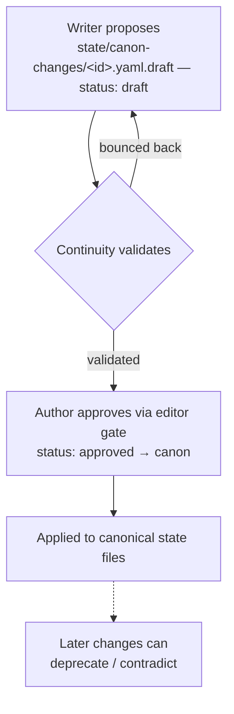
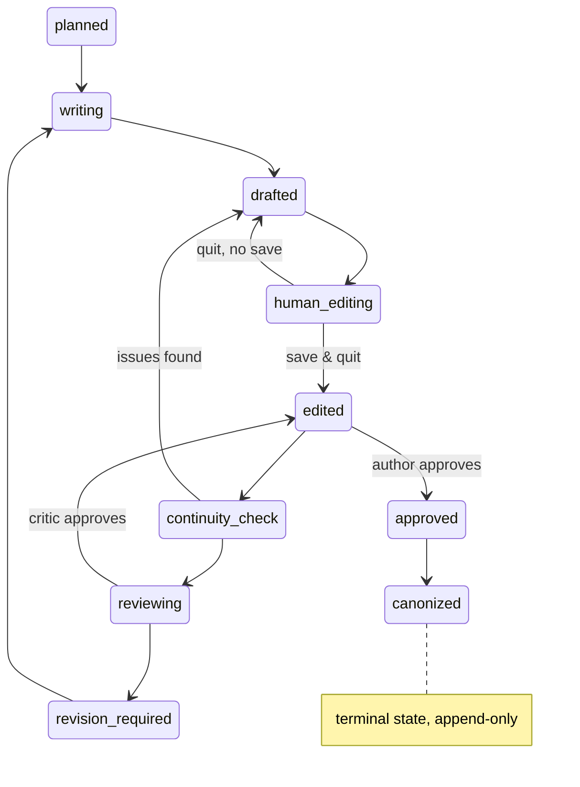

# pi-novel-scribe — Business Logic Overview

> **What this is:** a synthesis of the project's business logic, produced by reading the
> spec and source on 2026-09-19. Written as a standalone briefing — for the full detail,
> read the sources listed at the bottom.
>
> **One-sentence summary:** it's a quality-gated assembly line for novels — agents draft
> and critique, but a derived-from-prose canon model, a strict state machine, and
> editor-based human gates guarantee the author always holds the keys to what becomes
> true in the story.

---

## 1. What it is

A **Pi extension for autonomous long-form novel writing**. The problem: LLM-assisted
novel writing collapses at scale — chapters contradict each other, characters "forget"
what they know, foreshadowing never pays off, and the human author loses track of what's
canon. This project solves it with an **agent pipeline governed by an explicit,
author-controlled state model**. The human author is the final authority on canon; the
agents propose, validate, and draft — never decide alone.

**Key architectural separation:** the _extension repo_ (this code — stateless, reusable)
is strictly divided from the _novel repo_ (a peer git repo holding all prose, characters,
world, canon state for one novel). One extension install serves N novels. (ADR-0001)

## 2. The production line (core pipeline)

| Agent          | Job                                                                                                                                          | Artifact it emits                              |
| -------------- | -------------------------------------------------------------------------------------------------------------------------------------------- | ---------------------------------------------- |
| **Director**   | Thin router. Matches user intent against `config/route.yaml` (9 intents), dispatches to agents. Never writes prose or canonical logic itself | routing decisions                              |
| **Planner**    | Structure: premise → snowflake → arcs → chapters → scene plans                                                                               | `plan:` block in chapter frontmatter           |
| **Writer**     | Prose drafting, consuming an approved plan                                                                                                   | `prose:` in chapter + `proposed_state_changes` |
| **Critic**     | Actionable critique segmented by category: story / character / pacing / prose / foreshadowing                                                | `review:` block with 5-field issues            |
| **Continuity** | Canon authority: validates writer proposals, derives character/reader knowledge, refreshes beliefs                                           | `state/character-beliefs.yaml`                 |

Each agent gets a **deterministically assembled scene-context packet** (chapter plan,
scene plan, POV character's profile + beliefs filtered to ≤ current chapter, active story
lines, last paragraph of prior prose). Composition is pure code, never LLM judgment — so
the prompt is reproducible. (CONTEXT.md, Q7)

## 3. The domain model (where the real business logic lives)

**Structure hierarchy:** `Novel → Major Arc → Arc → Chapter → Scene` — scene is
first-class; beats are deferred.

**The three-layer knowledge model** — designed for mysteries and unreliable narrators:

1. **World truth** (`state/world-truth.yaml`) — authored only. What's _actually_ true,
   regardless of who knows it
2. **Character knowledge** — derived from POV by default: "Sara knows X" because a scene
   where Sara holds POV states it. Author overrides via `state/character-beliefs.yaml`
   handle unreliable narration
3. **Reader knowledge** — pure derivation: reader knows F at chapter N if any approved
   chapter ≤ N reveals F. No store at all

**Story Lines track information, not events.** Each named line (`sara-investigation`,
`the-watcher`) has a `kind` (`bright | dark | subplot | red-herring`) plus its own state
machine: `objective / current_state / next_milestone / hidden_information /
planned_reveal`. The Critic walks active lines every review.

**Other tracked entities** (in `extensions/novel/schemas.ts`):

- **Foreshadowing** — `planted → partial → revealed | subverted`, with planted-in and
  revealed-in chapter anchors and an optional owner line
- **UnresolvedThread** — `open → in_progress → resolved | abandoned`
- **TimelineEvent** — chapter-anchored, with optional intra-chapter time offset
- **Character** — id, aliases, pronouns, role
- **CanonChange** — the proposal record (see §4)

## 4. Canon lifecycle — "prose is the source, canon is derived"

Canonical facts are **never authored independently** — they derive from approved prose.
Approved prose is **append-only** (edits require a new chapter version; the extension
refuses in-place overwrites), which makes derivation cheap and safe.

Any fact the Writer introduces flows through a gated proposal pipeline
(`extensions/novel/canon.ts`):

No silent canon mutations — writers must go through this pipeline, never `write`/`edit`
directly.

## 5. Workflow engine — resumable chapter state machine

Each chapter's `status` frontmatter (not a session log) is the canonical workflow
state — 13 edges, one revise loop (`extensions/workflow/transitions.ts`):

On session start, the extension scans for non-terminal chapters and offers to resume —
pi crashing during `human_editing` never loses work.

## 6. Human approval gates — the editor _is_ the approval UI

Approval levels 0–3 (automatic / notify / ask / explicit approval). For level 2–3, the
artifact opens in `$VISUAL` → `$EDITOR` → platform default, and **editor exit semantics
decide the outcome**:

- **Save & quit** → edits become new state, proceed
- **Quit, no diff** → proposal approved as-stated
- **Quit without save** → rollback, workflow aborts gracefully

Every gate decision is logged (path, before/after hashes) so `/resume` can replay
context.

## 7. Intent routing (the Director's brain)

`config/route.yaml` defines 9 intents with keyword/phrase triggers and priority:

| Intent                                             | Priority | Primary    | Notes                                         |
| -------------------------------------------------- | -------- | ---------- | --------------------------------------------- |
| `approve_pending_change` / `reject_pending_change` | 200      | director   | approval responses always outrank new work    |
| `write_chapter`                                    | 100      | writer     | the headline `/novel write` workflow          |
| `plan_chapter`                                     | 95       | planner    | `/novel plan`                                 |
| `review_chapter`                                   | 90       | critic     | `/novel review`; never auto-advances status   |
| `revise_chapter`                                   | 88       | writer     | `/novel revise`; apply review issues          |
| `continue_novel`                                   | 80       | planner    | `/novel continue`; resume from where left off |
| `inspect_novel_state`                              | 70       | continuity | read-only, guaranteed                         |
| `investigate_continuity_break`                     | 65       | continuity | diagnose suspected contradictions             |

Unmatched input → Director asks exactly one clarifying question. Explicit
`/novel <cmd>` always beats keyword matching. Routes can carry `requires_state` gates
(e.g. there must be a next unapproved chapter before `write_chapter` dispatches).

## 8. Supporting systems

- **LLM Wiki** (`extensions/wiki/`, ADR-0006) — read-only SQLite over a reference corpus
  (story_lines, scene_templates, writing_patterns, prompts); FTS5 BM25 candidates →
  LLM rerank → top-5 with rationale. Exposed as a `wiki_search` tool the Director
  attaches as a support agent
- **Multilingual en/zh** (`extensions/i18n/`, ADR-0007) — localized prompts, tool
  descriptions, status display, errors; override chain: command flag > chapter
  frontmatter > settings > auto-detect > fallback
- **Recursion safety** — hybrid caps: prompt-instructed + runtime-enforced
  (`max_agent_depth: 2`, `max_subagents_per_task: 4`, `max_iterations: 2`,
  `max_tokens_per_call: 8000`, `max_time_seconds: 120`) so agent loops must eventually
  reach a human
- **tmux status widget** (`extensions/tmux/widget.ts`) — surfaces resumable chapters,
  active story lines, pending canon drafts; works in plain pi without tmux

## 9. The five hard invariants

1. **The author is the final authority on canon** — never auto-promote writer-generated
   facts
2. **Character knowledge ≠ world truth** — modeled separately (`fact.truth` vs
   `knowledge.{character, reader}`), always
3. **The Writer consumes an approved plan** — provisional plans must be explicit
4. **Story Lines track information** (who knows what, what the reader suspects), not
   just events
5. **Scene is first-class** — chapters decompose into scenes; beats can wait

## 10. Current status

v0.1 milestone **complete**: all 9 phases shipped (substrate → editor → agents →
schemas → continuity → workflow → tmux widget → wiki → i18n), **232/232 tests
passing**, ~82% statement coverage. Notably, subagents and skills are deliberately _not_
shipped — per ADR-0005, they're "earned by measured need, not declared up front."

---

## Sources read

| File                                 | Role                                                                        |
| ------------------------------------ | --------------------------------------------------------------------------- |
| `README.md`, `AGENTS.md`             | project overview + conventions                                              |
| `CONTEXT.md`                         | canonical glossary — 16 locked decisions (Q1–Q16)                           |
| `pi-novel-architecture-review.md`    | the full spec (v0.4)                                                        |
| `config/route.yaml`                  | Director routing table (9 intents + approval routes)                        |
| `extensions/novel/schemas.ts`        | P0 domain model (8 entities)                                                |
| `extensions/novel/canon.ts`          | canon change lifecycle (propose → validate → apply)                         |
| `extensions/workflow/transitions.ts` | 12-edge workflow state graph                                                |
| `docs/adr/0001–0007`                 | decision records (novel repo split, director router, subagents, wiki, i18n) |
