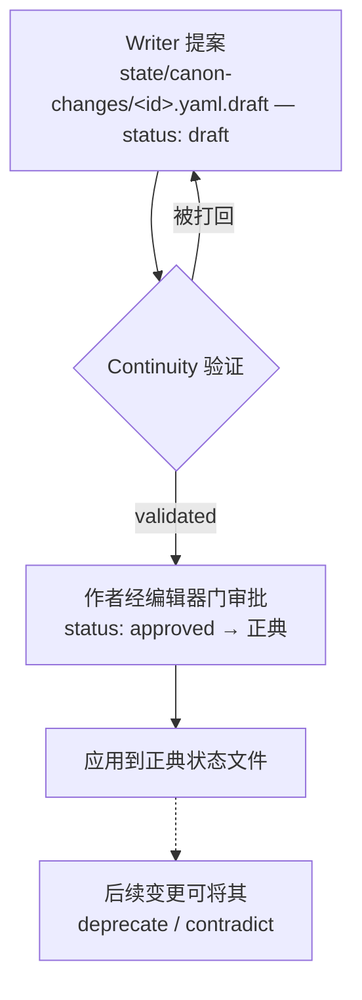
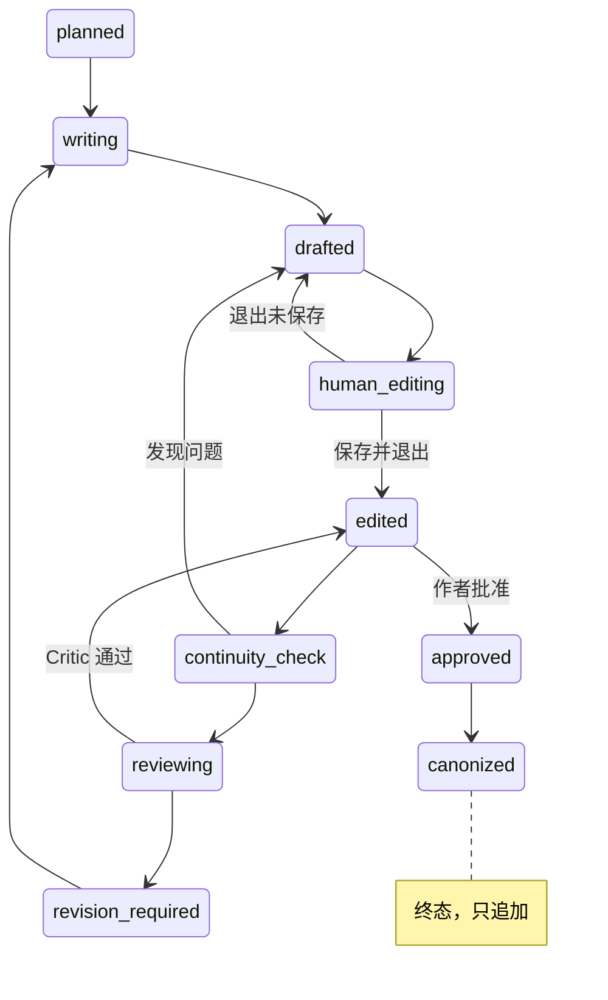

# pi-novel-scribe — 业务逻辑概览（中文版）

> **说明：** 本文是 [BUSINESS-LOGIC.md](./BUSINESS-LOGIC.md) 的中文版本，基于 2026-09-19
> 对规格文档与源码的阅读整理而成，可独立阅读。需要完整细节时，请查阅文末列出的原始资料。
>
> **一句话总结：** 这是一条为小说生产而设的质量把关流水线 —— 智能体负责起草与批评，
> 而"正典由已批准正文派生"的模型、严格的状态机、以及以编辑器为界面的人工审批门，
> 共同保证作者始终掌握"故事中什么成为事实"的最终权力。

---

## 1. 这是什么

一个用于**自主长篇小说写作的 Pi 扩展**。它要解决的问题：LLM 辅助的小说写作在规模
扩大后会崩塌 —— 章节之间相互矛盾、角色"忘记"自己知道什么、伏笔永远收不回、人类
作者逐渐搞不清哪些还算正典（canon）。本项目用一个**由显式的、作者掌控的状态模型
所治理的智能体流水线**来解决。人类作者是正典的最终权威；智能体只负责提议、验证
和起草 —— 从不单独做决定。

**关键架构分离：**_扩展仓库_（本代码 —— 无状态、可复用）与*小说仓库*（一个对等的
git 仓库，存放某一部的全部正文、角色、世界观、正典状态）严格分离。一次扩展安装可
服务 N 部小说。（ADR-0001）

## 2. 生产线（核心流水线）

| 智能体         | 职责                                                                                                       | 产出的制品                                   |
| -------------- | ---------------------------------------------------------------------------------------------------------- | -------------------------------------------- |
| **Director**   | 薄路由层。将用户意图与 `config/route.yaml`（9 个意图）匹配，再分派给各智能体。自己从不写正文、不写正典逻辑 | 路由决策                                     |
| **Planner**    | 结构规划：前提 → 雪花法 → 弧 → 章节 → 场景计划                                                             | 章节 frontmatter 中的 `plan:` 块             |
| **Writer**     | 正文起草，消费已批准的计划                                                                                 | 章节中的 `prose:` + `proposed_state_changes` |
| **Critic**     | 可执行的批评意见，按类别分段：故事 / 角色 / 节奏 / 文笔 / 伏笔                                             | 带五字段问题的 `review:` 块                  |
| **Continuity** | 正典权威：验证 Writer 的提议、派生角色/读者知识、刷新信念                                                  | `state/character-beliefs.yaml`               |

每个智能体拿到的都是一个**确定性组装的场景上下文包**（scene-context packet：章节
计划、场景计划、POV 角色的档案与"≤ 当前章节"过滤后的信念、活跃故事线、上一段正
文的结尾）。组装是纯代码，从不依赖 LLM 判断 —— 因此提示词可复现。（CONTEXT.md，Q7）

## 3. 领域模型（业务逻辑真正的核心）

**结构层级：** `Novel → Major Arc → Arc → Chapter → Scene` —— 场景（Scene）是一等
公民；节拍（Beat）延后。

**三层知识模型** —— 为悬疑与不可靠叙述者而设计：

1. **世界真相**（`state/world-truth.yaml`）—— 仅由作者撰写。无论谁知道，_实际上_
   为真的是什么
2. **角色知识** —— 默认由 POV 派生："Sara 知道 X"，因为某个 Sara 持有 POV 的场景
   陈述了它。作者通过 `state/character-beliefs.yaml` 覆盖，以处理不可靠叙述
3. **读者知识** —— 纯派生：若任何 ≤ N 章的已批准章节揭示了 F，则读者在第 N 章知道
   F。完全没有存储

**故事线（Story Line）追踪的是信息，而非事件。** 每条命名线（`sara-investigation`、
`the-watcher`）有一个 `kind`（明线 bright / 暗线 dark / 支线 subplot / 烟雾弹
red-herring），加上各自独立的状态机：`objective / current_state / next_milestone /
hidden_information / planned_reveal`。Critic 每次评审都会遍历活跃线。

**其他被追踪的实体**（见 `extensions/novel/schemas.ts`）：

- **伏笔（Foreshadowing）** —— `planted → partial → revealed | subverted`，带埋设
  章节与揭示章节锚点，可归属于某条故事线
- **未解线索（UnresolvedThread）** —— `open → in_progress → resolved | abandoned`
- **时间线事件（TimelineEvent）** —— 锚定到章节，可带章内时间偏移
- **角色（Character）** —— id、别名、代词、角色类型
- **正典变更（CanonChange）** —— 提案记录（见 §4）

## 4. 正典生命周期 —— "正文是源头，正典是派生"

正典事实**从不被独立撰写** —— 它们从已批准的正文派生。已批准的正文是**只追加**
的（修改需要新版本章节；扩展拒绝原地覆写），这让派生既廉价又安全。

Writer 引入的任何事实都要经过带门禁的提案流水线（`extensions/novel/canon.ts`）：

不存在静默的正典变更 —— Writer 必须走这条流水线，绝不直接 `write`/`edit`。

## 5. 工作流引擎 —— 可恢复的章节状态机

每个章节 frontmatter 里的 `status`（而非会话日志）才是规范的工作流状态 ——
13 条边、一个修订循环（`extensions/workflow/transitions.ts`）：

会话启动时，扩展会扫描处于非终态的章节并提议恢复 —— pi 若在 `human_editing` 期间
崩溃，工作绝不会丢失。

## 6. 人工审批门 —— 编辑器*就是*审批界面

审批级别 0–3（自动 / 通知 / 询问 / 显式批准）。对级别 2–3，制品会在
`$VISUAL` → `$EDITOR` → 平台默认编辑器中打开，**编辑器退出语义决定审批结果**：

- **保存并退出** → 编辑内容成为新状态，继续推进
- **退出且无改动（无 diff）** → 提案按原样批准
- **不保存退出** → 回滚，工作流优雅中止

每次门决策都会记录（文件路径、前后哈希），以便 `/resume` 重放上下文。

## 7. 意图路由（Director 的大脑）

`config/route.yaml` 定义了 9 个意图，各带关键词/短语触发器与优先级：

| 意图                                               | 优先级 | 主智能体   | 备注                                |
| -------------------------------------------------- | ------ | ---------- | ----------------------------------- |
| `approve_pending_change` / `reject_pending_change` | 200    | director   | 审批响应永远压过新工作              |
| `write_chapter`                                    | 100    | writer     | 头牌工作流 `/novel write`           |
| `plan_chapter`                                     | 95     | planner    | `/novel plan`                       |
| `review_chapter`                                   | 90     | critic     | `/novel review`；从不自动推进状态   |
| `revise_chapter`                                   | 88     | writer     | `/novel revise`；落实评审问题       |
| `continue_novel`                                   | 80     | planner    | `/novel continue`；从上次中断处恢复 |
| `inspect_novel_state`                              | 70     | continuity | 保证只读                            |
| `investigate_continuity_break`                     | 65     | continuity | 诊断疑似矛盾                        |

未匹配的输入 → Director 只问一个澄清性问题。显式的 `/novel <cmd>` 永远优先于关键
词匹配。路由可携带 `requires_state` 前置门（例如 `write_chapter` 分派前必须存在下一
个未批准章节）。

## 8. 支撑系统

- **LLM 维基**（`extensions/wiki/`，ADR-0006）—— 对参考语料库（story_lines、
  scene_templates、writing_patterns、prompts）的只读 SQLite；FTS5 BM25 候选 →
  LLM 重排 → 带理由的 top-5。以 `wiki_search` 工具形式暴露，Director 将其作为
  支援智能体挂载
- **多语言 en/zh**（`extensions/i18n/`，ADR-0007）—— 本地化的提示词、工具描述、
  状态显示、错误信息；覆盖链：命令行参数 > 章节 frontmatter > 设置 > 自动检测 > 兜底
- **递归安全** —— 混合限制：提示词声明 + 运行时强制（`max_agent_depth: 2`、
  `max_subagents_per_task: 4`、`max_iterations: 2`、`max_tokens_per_call: 8000`、
  `max_time_seconds: 120`），确保智能体循环最终必须回到人类
- **tmux 状态组件**（`extensions/tmux/widget.ts`）—— 展示可恢复章节、活跃故事线、
  待处理的正典草案；无需 tmux 也能在纯 pi 中工作

## 9. 五条硬性不变量

1. **作者是正典的最终权威** —— 永不自动把 Writer 生成的事实提升为正典
2. **角色知识 ≠ 世界真相** —— 永远分开建模（`fact.truth` 与
   `knowledge.{character, reader}`）
3. **Writer 只消费已批准的计划** —— 临时计划必须显式声明
4. **故事线追踪信息**（谁知道什么、读者怀疑什么），而不只是事件
5. **场景是一等公民** —— 章节分解为场景；节拍可以等

## 10. 当前状态

v0.1 里程碑**已完成**：全部 9 个阶段交付（基底 → 编辑器 → 智能体 → schema →
连续性 → 工作流 → tmux 组件 → 维基 → i18n），**232/232 测试通过**，语句覆盖率约
82%。值得注意的是，子智能体与技能是*刻意*未发布的 —— 按 ADR-0005，它们
"靠实测需求赢得，而非预先声明"。

---

## 阅读来源

| 文件                                 | 作用                                                            |
| ------------------------------------ | --------------------------------------------------------------- |
| `README.md`、`AGENTS.md`             | 项目概览 + 约定                                                 |
| `CONTEXT.md`                         | 规范术语表 —— 16 项已锁定决策（Q1–Q16）                         |
| `pi-novel-architecture-review.md`    | 完整规格（v0.4）                                                |
| `config/route.yaml`                  | Director 路由表（9 个意图 + 审批路由）                          |
| `extensions/novel/schemas.ts`        | P0 领域模型（8 个实体）                                         |
| `extensions/novel/canon.ts`          | 正典变更生命周期（提案 → 验证 → 应用）                          |
| `extensions/workflow/transitions.ts` | 12 条边的工作流状态图                                           |
| `docs/adr/0001–0007`                 | 决策记录（小说仓库分离、Director 路由器、子智能体、维基、i18n） |
