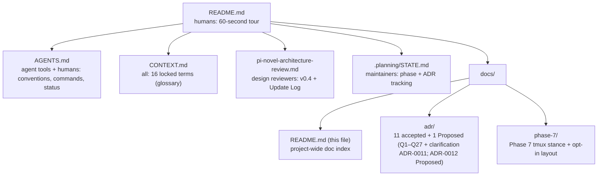

# pi-novel-scribe — docs index

Project documentation. Read top-to-bottom on first contact; jump to a
specific doc only when you know what you're looking for.

## Top-level

| Doc                                                                   | Audience                                   | Read when                                             |
| --------------------------------------------------------------------- | ------------------------------------------ | ----------------------------------------------------- |
| [README.md](../README.md)                                             | humans (project landing)                   | You want a 60-second tour.                            |
| [AGENTS.md](../AGENTS.md)                                             | agent tools (Copilot / Claude / Pi itself) | You need conventions, commands, status table.         |
| [CONTEXT.md](../CONTEXT.md)                                           | all                                        | You want the canonical glossary of 16 locked terms.   |
| [pi-novel-architecture-review.md](../pi-novel-architecture-review.md) | design reviewers                           | You want the original spec (v0.4) and the Update Log. |
| [.planning/STATE.md](../.planning/STATE.md)                           | maintainers                                | You want milestone + phase + ADR tracking.            |

## Architecture Decision Records

ADR directory: [`adr/`](./adr/)

| ADR                                                         | Decision                                                                                              | Locks                             |
| ----------------------------------------------------------- | ----------------------------------------------------------------------------------------------------- | --------------------------------- |
| [0001](./adr/0001-separate-novel-repo.md)                   | Separate novel repo                                                                                   | Q1                                |
| [0002](./adr/0002-prose-as-source-canon-derived.md)         | Prose-as-source, canon-as-derived                                                                     | Q2                                |
| [0003](./adr/0003-substrate-first-mvp.md)                   | Substrate-first MVP                                                                                   | Q10                               |
| [0004](./adr/0004-director-route-yaml-router.md)            | Director as `route.yaml` router with LLM fallback                                                     | Q13 + Q16                         |
| [0005](./adr/0005-subagents-earned-not-declared.md)         | Subagents earned, not declared                                                                        | Q11                               |
| [0006](./adr/0006-llm-wiki.md)                              | LLM Wiki — cross-project SQLite reference corpus                                                      | Q17 + Q18                         |
| [0007](./adr/0007-multilingual.md)                          | Multilingual support (en + zh)                                                                        | Q19 + Q20                         |
| [0008](./adr/0008-wiki-first-context.md)                    | Wiki-first context — corpus as mandatory prompt context                                               | Q21 + Q22 + Q23                   |
| [0009](./adr/0009-multi-chapter-planning.md)                | Multi-chapter planning — plan-only scope, one LLM call → N plan blocks                                | Q24 + Q25                         |
| [0010](./adr/0010-sample-novel-and-ci-smoke.md)             | Sample novel + CI smoke — representative shape, offscreen vitest runner                               | Q26 + Q27                         |
| [0011](./adr/0011-multi-chapter-tool-param.md)              | Multi-chapter `chapters` lives on the tool, not the route — clarifies ADR-0009 §Implementation impact | — (no new Q)                      |
| [0012](./adr/0012-v0-3-writer-safety-and-embedding-eval.md) | v0.3 — writer frontmatter safety + embedding retrieval evaluation                                     | Q28 + Q29 + Q30 + Q31 + Q32       |
| [0013](./adr/0013-v0-4-prompt-improvement.md)               | v0.4 — prompt improvement (Markdown-only; SQLite deferred to v0.5+)                                   | Q33 + Q34 + Q35 + Q36 + Q37 + Q38 |

Thirteen issued, zero open. Every locked Q-decision traces to an ADR; ADR-0011 is the only clarification-only ADR (no new Q).

## Per-phase

| Phase             | Doc                                      |
| ----------------- | ---------------------------------------- |
| Phase 7 — tmux UI | [phase-7/README.md](./phase-7/README.md) |

(Phase 7 is the only phase with its own doc — it's the one with user-facing
opt-in configuration. The other phases ship in `extensions/` and `tests/`
with their conventions captured in `AGENTS.md`.)

## How this doc set fits together

Update `STATE.md` first when milestones change, then mirror the change into
`AGENTS.md` and `README.md`. ADRs are append-only — never edit an issued
ADR; supersede it with a new ADR.
