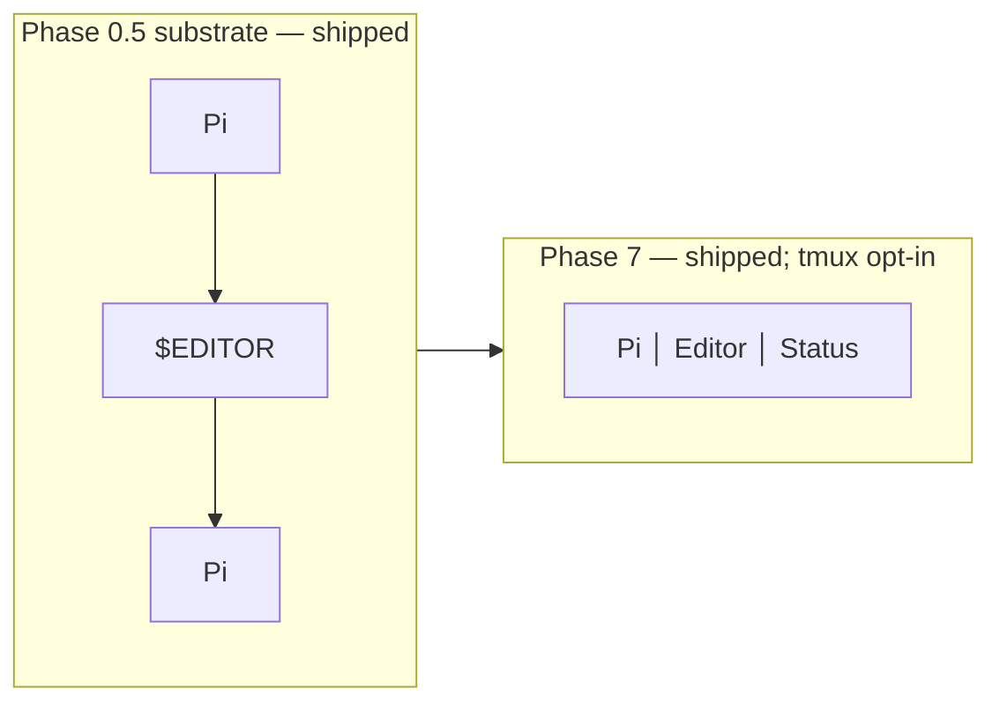

# Phase 7 — tmux UI

Phase 7 is **wired**. Per review §16, tmux is an **optional** UI adapter, and
the implementation ladder is:

The substrate (Phase 0.5) shipped early — opening `$VISUAL`/`$EDITOR` is a
process fork. Phase 7 adds a *split-pane* layout where the editor runs in its
own tmux pane and pi stays responsive in another, plus a pi-side custom
widget that fills the status pane content whether or not tmux is used.

## Components

| File | Purpose |
|---|---|
| [`tmux-conf-snippet.conf`](./tmux-conf-snippet.conf) | tmux.conf excerpt. Drop into your `~/.tmux.conf` to get the bind key + pane layout. |
| [`layout.sh`](./layout.sh) | Bash helper that launches a tmux session named `novel-scribe` with the layout configured. |
| [`../../extensions/tmux/widget.ts`](../../extensions/tmux/widget.ts) | The pi-side status widget — works in plain pi (no tmux required). Wired into `extensions/index.ts` via `registerStatusWidget(pi)`. |
| [`../../tests/widget.test.ts`](../../tests/widget.test.ts) | 7 vitest specs covering `buildWidgetLines` against `collectWidgetState`. |

## Architectural stance

- We do **not** ship tmux as a runtime dependency. The pi extension
  itself doesn't draw the UI; tmux does. What we ship is a layout the
  user opts into, plus a pi-side custom widget that fills the Status
  pane content.

- The pi extension provides three things for Phase 7:

  1. **A custom widget** rendered in the pi TUI itself — works
     *without* tmux. Shows resumable chapter list (Q9 data), current
     active story lines, pending canon-change dockets. Wired on
     `session_start`.

  2. **A tmux.conf excerpt** — the *user* copies relevant key bindings
     into their existing `~/.tmux.conf`. Includes `bind +n` (open
     layout) and `bind +w` (open editor pane).

  3. **A `layout.sh` helper** — non-required. Spawns a tmux session
     where the right pane runs `$VISUAL` on the current chapter and
     the left pane runs pi.

- Future UIs (zellij, neomux, raw Kitty panels) plug in via the same
  widget adapter; tmux is just the first.

## What this does NOT do

- Does not implement a tmux control-mode orchestrator. We do not
  control tmux from pi (read or write) — the user sets up panes, pi
  runs in one of them.
- Does not auto-launch an editor pane. The user opens their editor
  in another pane via their normal muscle memory (`$VISUAL $file`).
- Does not script file sync between panes. The user is responsible
  for `:w` / autosave in their editor of choice.

## Why this is opt-in and not built-in

Per review §16: *"Do not make tmux a dependency of the core workflow
engine."* Any built-in coupling would force a multiplexer on users
who don't want one. The widget works in plain pi; the tmux config
opts in for those who want it.
